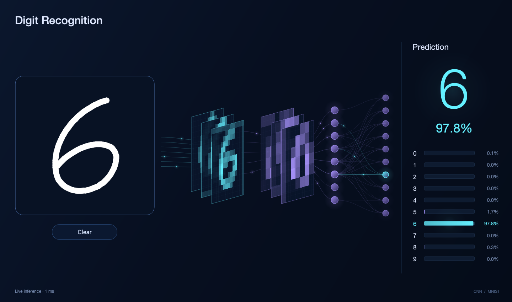

# DigitFlow — Digit Recognition

纯 Python 桌面应用：鼠标手写数字，实时显示 CNN 特征图、连接动画和 0–9 的输出概率。英文界面，深色背景，青紫色微光。



## 启动

项目包含训练好的模型。本机开发环境已配置虚拟环境，可在项目目录运行以下命令；首次下载仓库时请先完成下方“新环境安装”。

```bash
.venv/bin/python main.py
```

也支持 `.venv/bin/python -m digit_recognition`，或激活环境后使用 `digit-recognition`。

- 鼠标左键拖动：手写一个数字，书写时自动识别。
- **Clear / Esc**：清空画布及识别结果。
- **Cmd+Z（macOS）/ Ctrl+Z（Windows、Linux）**：撤销上一笔。

加载模型后可离线使用。应用不会上传笔迹，也不会在书写时训练。

## 新环境安装

需要 Python 3.11 或以上版本，推荐使用已验证的 Python 3.12。无须浏览器、Node.js 或独立显卡。

```bash
python3 -m venv .venv
source .venv/bin/activate
python -m pip install -e ".[dev]"
python main.py
```

Windows 使用 `.venv\Scripts\activate` 激活环境。只运行应用时可安装 `python -m pip install -e .`。

`pyproject.toml` 声明全部直接依赖，`requirements-lock.txt` 保存本次验证环境的精确版本和传递依赖。兼容环境可按以下方式复现：

```bash
python -m pip install -r requirements-lock.txt
python -m pip install --no-deps -e .
```

| 依赖 | 用途 |
| --- | --- |
| NumPy | 笔迹裁剪、质心计算、数组变换、激活聚合、特征图颜色映射 |
| Pillow | 保持宽高比缩放手写图像 |
| PySide6 | 原生窗口、鼠标输入、自定义绘图、动画和后台线程 |
| PyTorch | CNN 训练与 CPU 推理 |
| Torchvision | MNIST 数据加载 |
| certifi | 训练下载时提供可信 HTTPS CA 证书 |
| pytest（dev） | 自动化测试；Qt 测试使用 PySide6 自带的 QtTest |
| setuptools、wheel（build） | Python 包构建与可编辑安装 |

当前验证环境为 macOS arm64 / Python 3.12.7。其他平台的 wheel 可用性可能不同，跨平台安装优先使用 `pyproject.toml` 解析兼容版本。

## 模型与训练

`artifacts/mnist_cnn.pt` 是实际训练得到的权重。

```text
28×28 grayscale
→ Conv(1→16, 3×3) → ReLU → MaxPool(2)
→ Conv(16→32, 3×3) → ReLU → MaxPool(2)
→ Flatten(1568) → Dense(64) → ReLU
→ Dropout(0.15, training only) → Dense(10)
```

预处理裁剪笔迹、缩放到 20×20 范围、补边到 28×28、按质心居中，再按 MNIST 参数归一化。空白输入不产生预测。推理使用 `eval()`、`inference_mode()` 和 Softmax。

本次训练使用随机种子 42、55,000 张训练样本、5,000 张独立验证样本和 6 个 epoch。使用验证集选权重，最后在 10,000 张测试样本上评估：验证准确率 **98.78%**，测试准确率 **98.93%**。记录见 `artifacts/mnist_cnn.json`。这不是鼠标手写准确率的保证，未完成的笔迹也可能得到较高模型概率。

重新训练：

```bash
python -m digit_recognition.train --epochs 6 --device cpu
```

首次训练需联网下载公开 MNIST 数据，之后使用 `data/` 缓存。参数包括 `--device auto|cpu|mps|cuda`、`--seed`、`--batch-size`、`--data-dir`、`--output`。默认替换本地权重，重启应用后生效。

自定义模型路径：`python main.py --model artifacts/mnist_cnn.pt`。

## 模块划分

```text
main.py                       # 启动入口
pyproject.toml                # 运行、开发及构建依赖
requirements-lock.txt         # 已验证环境的精确版本
src/digit_recognition/
  config.py                   # 路径与共享常量
  preprocessing.py            # NumPy 预处理，不依赖 Qt
  model.py                    # CNN 定义，不依赖 Qt
  train.py                    # 独立训练流程
  inference.py                # 权重加载与推理快照，不依赖 Qt
  controller.py               # 后台推理、最新画面调度与清空屏障
  app.py                      # 参数解析与应用生命周期
  ui/
    canvas.py                 # 手写、清空、撤销
    network.py                # 特征图、聚合节点与连接动画
    prediction.py             # 概率条与识别结果
    theme.py                  # 颜色、字体和绘图辅助
    window.py                 # 界面组合
artifacts/                    # 权重、实际评估记录和应用截图
tests/                        # 预处理、推理、调度及 GUI 测试
scripts/capture_preview.py    # 通过 Qt 鼠标事件生成运行截图
```

UI 通过信号接收结果，不直接调用模型。后台最多处理一帧，繁忙时仅保留最新画布状态；清空或撤销后不会恢复旧结果。连续书写显示最近完成的结果，避免鼠标不断移动导致推理结果被全部丢弃。推理调度间隔 65 ms，动画定时器 16 ms，实际速度取决于设备。

每组特征图固定展示训练时选出的 3 个真实池化输出通道。每个紫色中间节点聚合 8 个隐藏单元，连线强度来自绝对贡献之和，每个输出只显示 3 条主要连线。粒子是数据流示意，不代表真实执行时序。概率数字来自实际 Softmax，概率条进行短暂平滑过渡。主识别数字使用 180 ms 淡入淡出；相同结果不重复触发动画，快速切换时从当前画面衔接，清空时立即移除数字。

## 验证

```bash
python -m pytest -q
python -m pip check
```

测试覆盖空白和边缘笔迹、位置不变性、模型缺失/损坏、概率归一化、特征变化、最新帧调度、清空时旧结果拦截、持续书写、撤销、窗口缩放和线程退出。测试自动使用 Qt offscreen 平台；模型测试使用项目自带权重。

生成真实应用截图（不是概念图）：

```bash
QT_QPA_PLATFORM=offscreen python scripts/capture_preview.py
```

输出到 `artifacts/app-preview.png`，同时生成小窗口及空白画布截图。正常使用时不要设置 `QT_QPA_PLATFORM=offscreen`。

模型缺失或损坏时，底部显示恢复命令，画布仍可使用。推理错误会显示并记录到终端。训练下载保持 HTTPS 证书验证。

组件文档：[Qt for Python](https://doc.qt.io/qtforpython-6/)、[PyTorch](https://docs.pytorch.org/)、[MNIST](https://docs.pytorch.org/vision/stable/generated/torchvision.datasets.MNIST.html)、[NumPy](https://numpy.org/doc/stable/)。
